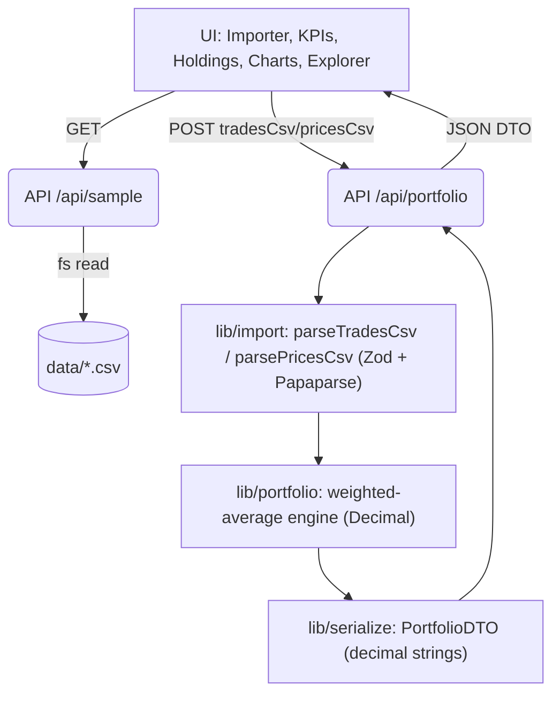

AI‑Assisted Crypto Portfolio Analytics
=====================================

A full-stack, serverless-friendly Next.js app that imports a crypto trade history and shows holdings, weighted-average cost, realized/unrealized P&L, allocations, and a transaction explorer. Built per the take‑home spec; deterministic math is isolated, and all currency/quantity math uses Decimal with rounding only for display. No live data, auth, or database.

Tech stack
- Next.js App Router + TypeScript
- decimal.js for precise money/quantity math
- Zod for CSV/data contracts
- Recharts for charts
- Vitest for tests
- Tailwind CSS for styling
- No DB/auth/live prices (sample CSVs bundled)

Local development
- Prereq: Node 20+ (this repo used Node 22)
- Install: npm install
- Dev: npm run dev
- Tests: npm test
- Lint: npm run lint
- Build: npm run build
- Start (prod): npm run start

Data
- Default data lives in data/trades.csv and data/prices.csv and is also exposed under public/data for convenience.
- On first load, the app uses the bundled sample and shows the price as_of timestamp. You can upload new CSVs (trades required, prices optional) and reset to the bundled sample at any time.
- Import is validated with actionable, per-row errors (all-or-nothing).

Architecture and data flow

Separation of concerns
- lib/portfolio: Pure, deterministic calculation engine (no I/O). Processes trades in timestamp order per asset using weighted-average cost basis:
  - BUY: costAdded = qty × price + fee; averageCost = newCostBasis / newQty (fee capitalized)
  - SELL: realized = (qty × price − fee) − (avgCost × qty); averageCost for remaining position unchanged; full close resets avg/cost basis to 0
  - Valuation: value = qty × currentPrice; unrealized = value − costBasis; totalPnL = realized + unrealized; fees = sum of BUY+SELL fees
- lib/import: CSV parsing + Zod validation; duplicate trade_id rejection; timestamps/enums/numbers validation; short-sell prevention (SELL never exceeds available).
- lib/serialize: Converts Decimal portfolio to string DTO for APIs; UI rehydrates with Decimal for display only.
- app/api: server route handlers.
- app/(ui): presentational UI (KPIs, table, charts, explorer).

Precision and rounding decisions
- All money/quantity math uses Decimal. No rounding is applied inside the engine.
- API returns decimal strings (full precision). UI rounds only for display:
  - Currency: 2 decimals
  - Quantities: up to 8 decimals
  - Percent: 2 decimals
- This avoids drift and ensures tests can assert exact results.

Features
- KPIs: Portfolio value, Cost basis, Realized P&L, Unrealized P&L, Total P&L, Total fees.
- Tabbed layout:
  - Open positions (current holdings): Quantity, Avg cost, Price, Cost basis, Value, Realized, Unrealized, Total P&L, Allocation.
  - Closed positions (lifecycle): Asset, Opened, Closed, Trade count, Peak qty, Total cost, Proceeds, Realized P&L, Fees.
  - Transactions: Filter by asset, exchange, side, date range; sort by timestamp; pagination; shows Gross, Fee, Realized P&L, Avg cost after, Qty after; totals footer for Gross and Fees.
- Charts: Allocation by value; Realized vs Unrealized P&L by asset. Handles negatives.
- Clicking any row in Open or Closed opens a modal with per-position KPIs and its transaction history (qty/avg cost after, realized delta and cumulative).
- States: Loading, empty, invalid import, missing prices, unexpected error. Gain/loss indicated by sign and icon, not just color.

Testing
- One command: npm test
- Unit tests: multiple BUYs, BUY fee included in avg cost, partial SELL, SELL fee reduces proceeds, full close then rebuy, short-sell rejection, invalid/duplicate rows. Positions engine tests cover: position splitting (full close then rebuy creates two positions), partial sells remain one position, open-position aggregation equals holdings, sum of realized across all positions equals portfolio realized, and modal data consistency (last cumulative realized equals position realized on closed positions).
- Reconciliation test against the full dataset (weighted-average per spec) asserts:
  - Totals: value 60620.89, cost basis 59969.24, realized -5052.96, unrealized 651.65, total P&L -4401.31, fees 2708.86
  - Per asset (qty, cost basis, value, realized, unrealized, fees):
    - BTC 0.07742920, 9114.34, 8633.36, -463.75, -480.98, 486.42
    - ETH 2.846898, 11648.43, 11458.76, -984.43, -189.66, 529.66
    - SOL 53.3643, 11433.18, 11126.46, -2408.93, -306.72, 518.99
    - CKB 1947047, 13382.76, 13921.39, 1499.63, 538.63, 525.21
    - DOGE 63970.78, 14390.53, 15480.93, -2695.48, 1090.40, 648.58
 - Invariant tests:
   - Per-asset sums (value, cost basis, realized, unrealized, fees) equal portfolio totals
   - Allocations sum to 1 (tiny epsilon)
   - Total P&L equals realized + unrealized (per asset and overall)
   - SELL does not change average cost of remaining position
   - After full close, quantity/cost/avg are zero
   - Deterministic results when input rows are shuffled (parser sorts by timestamp)
   - Cost basis is never negative

Assumptions, limitations, tradeoffs
- No database/auth; serverless-friendly. The default experience always uses the bundled sample. Uploads are ephemeral (stored in-memory/localStorage). This keeps deploys simple on Vercel and avoids managing persistent state.
- All-or-nothing import: any validation error aborts import with per-row errors.
- Reading sample CSVs from the repo at runtime is fine for serverless (static files bundled). For very large files, a streaming CSV parser and worker offloading would be preferable.
- No live pricing; the displayed as_of timestamp comes from prices.csv.

Deployment
- Target: Vercel (serverless). Provide a public URL in this section after deployment.
- Deployment URL: <add-your-Vercel-URL-here>

Future improvements
- Add export/download of computed portfolio snapshot and per-asset ledgers.
- Virtualized transaction table for very large histories.
- CSV import wizard with row-level preview and downloadable error report.
- Advanced metrics (time-weighted returns, drawdowns), multi-currency support, and lot selection strategies.
- Accessibility polish and keyboard navigation for the transaction explorer.
- Snapshot caching for fast reloads across sessions.

